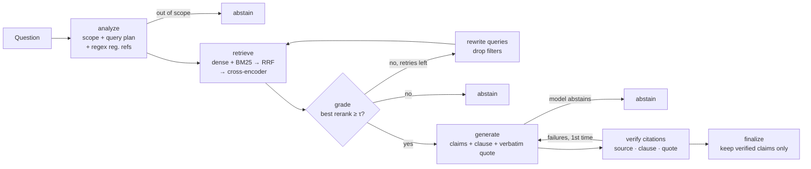

# Automotive Safety Standards Copilot

A retrieval-augmented assistant that answers vehicle-safety questions **only from the text of the
regulations**, cites every statement down to the clause (`UN R152 5.2.1.1`, `FMVSS 208 S6.4`,
`UN R94 Annex 3 §1.3.1`), verifies each citation verbatim, and **abstains** when nothing in the corpus
grounds the question.

**Stack:** Python 3.12 · LangGraph · ChromaDB · BM25 · BGE embeddings + cross-encoder reranker ·
Claude (Anthropic SDK, structured outputs) · Streamlit

## Corpus

Every document is fetched from its official publisher by `copilot-download`:

| Family | Documents | Pages | Clauses | Source |
|---|---|---|---|---|
| FMVSS (49 CFR 571) | 22 standards (101–305a) | ~222 (CFR page-equivalents) | 3,181 | eCFR versioner API (XML) |
| UN/ECE Regulations | 14 (R14, R16, R17, R48, R79, R94, R95, R100, R127, R129, R135, R137, R152, R157) | 1,100 | 7,280 | UN Official Document System (latest consolidated revision) |
| Euro NCAP protocols | 10 (2026 crash protection & crash avoidance) | 445 | 903 | cdn.euroncap.com |
| **Total** | **46** | **1,767** | **11,364** → 3,565 chunks | |

Exact figures are written to `data/processed/manifest.json` on every build.

## Architecture



**Ingestion** (`src/copilot/ingest/`)
- `parse_fmvss.py` — eCFR XML → `S`-numbered clauses with heading breadcrumbs; captioned tables become their
  own citable clauses (`FMVSS 108 Table I-a`).
- `parse_pdf.py` — layout-aware segmentation of UN/ECE and Euro NCAP PDFs. A line starts a clause only if it
  sits in the number column, is a *plausible outline successor* of the current clause (child, sibling or
  ancestor's sibling), and isn't followed by a unit — which rejects wrapped lines like "2.5 m …", table cells
  and footnotes. Annex/Appendix headings (detected by font size) reset numbering, giving ids like
  `Annex 3 §2.1`. Euro NCAP's auto-numbered level-2 headings, which are lost in extraction, are
  re-numbered from their font style.
- `chunk.py` — clause-aware chunks that never cross a top-level section; each chunk records the exact clause
  numbers it contains, which is what citation verification checks against.

**Retrieval** (`src/copilot/retrieval/hybrid.py`) — ChromaDB (cosine, `BAAI/bge-small-en-v1.5`) plus BM25 with
a tokenizer that keeps clause numbers intact, fused with Reciprocal Rank Fusion, then rescored by
`BAAI/bge-reranker-base`. Each candidate is scored against every planned query phrasing and the max is kept,
so lay phrasing ("backup camera picture") still clears the gate through its technical rewrite.
Questions that name several regulations ("FMVSS 214 vs UN R135") are searched per regulation and merged.

**Generation and verification** (`src/copilot/graph/`) — Claude returns a typed `Answer` (Pydantic structured
output): a list of claims, each with `source`, `clause` and a verbatim `quote`. `verify.py` checks
deterministically that the source exists, the clause is in that excerpt, and the quote occurs in it
(normalising whitespace, hyphenation and typographic quotes). Failures go back to the model once with
specific feedback; claims that still fail are removed, and if none survive the copilot abstains.

**Abstention** happens at four gates: out-of-scope question; no excerpt above the reranker threshold after
query rewriting; the model finds no supporting provision; or no claim survives verification. Questions that
name an unindexed regulation (e.g. FMVSS 302) are flagged so the model cannot answer from memory.

## Evaluation

`eval/dataset.jsonl` holds 82 questions written from the parsed clause text: 62 answerable (single-clause
lookups, cross-regime comparisons, lay paraphrases), each with gold clause ids and reference facts, plus 20
unanswerable (unindexed regulations such as FMVSS 302 / UN R10 / R13-H, out-of-corpus programmes such as
IIHS / C-NCAP, details absent from the regulations, and off-topic questions).

| Metric | How it is measured |
|---|---|
| Retrieval hit@k / recall@k / MRR | gold clause ids vs retrieved chunks (deterministic) |
| Retrieval precision@5 | LLM judge: share of top-5 excerpts relevant to the question |
| Citation grounding | share of citations whose clause is in the cited excerpt and whose quote occurs verbatim (model draft, before filtering) |
| Faithfulness | LLM judge: share of final claims fully supported by the excerpts they cite |
| Answer correctness | LLM judge: share of reference facts stated in the answer |
| Abstention | abstain rate on unanswerable, false-abstain rate on answerable |

```bash
python -m eval.run_eval --retrieval-only   # no LLM calls
python -m eval.run_eval --workers 4        # full pipeline + judges (needs ANTHROPIC_API_KEY)
```

### Results

Retrieval, measured without any LLM (raw question as the only query, `eval/results/latest_retrieval.json`):

| hit@1 | hit@3 | hit@5 | recall@5 | MRR |
|---|---|---|---|---|
| 72.6% | 95.2% | 98.4% | 95.2% | 0.838 |

End-to-end results (faithfulness, citation grounding, precision@5, correctness, abstention): *pending the first
full run — see `eval/results/latest.json` and the Evaluation tab in the app once it has been run.*

## Quick start

```bash
uv venv --python 3.12 && uv pip install -e ".[dev]"
cp .env.example .env               # add ANTHROPIC_API_KEY (or run `ant auth login`)

copilot-download                   # ~45 MB from eCFR, UN ODS and Euro NCAP
copilot-index                      # parse → chunk → embed → ChromaDB (a few minutes on CPU/MPS)

streamlit run app/streamlit_app.py
copilot-ask "How early must an AEBS warn before emergency braking under UN R152?" --trace
pytest                             # unit + offline graph tests (no API calls)
```

Configuration lives in `src/copilot/config.py` (override with `COPILOT_*` environment variables): models,
chunk sizes, retrieval depths, the reranker abstention threshold, and retry limits.

## Project layout

```
config/sources.yaml          corpus manifest (FMVSS sections, UN regulation numbers, NCAP protocol URLs)
src/copilot/ingest/          download, parse (eCFR XML, PDF), chunk, build index
src/copilot/retrieval/       embeddings, hybrid search + rerank
src/copilot/graph/           LangGraph pipeline, prompts, schemas, citation verifier, reference detection
src/copilot/llm.py           Anthropic SDK wrapper (structured outputs, prompt caching, refusal fallback)
app/streamlit_app.py         chat UI, corpus browser, eval dashboard
eval/                        dataset, judges, harness, results
tests/                       unit tests and offline graph tests
```

## Limitations

- Regulatory text changes; the index reflects the eCFR date and UN revisions recorded in the manifest.
- R21 (interior fittings) was dropped because its only published PDF is a scanned image without a text layer.
- A few Euro NCAP tables use fonts whose glyphs extract with missing letters; those passages retrieve less
  reliably.
- Answers are research aids, not compliance determinations.
